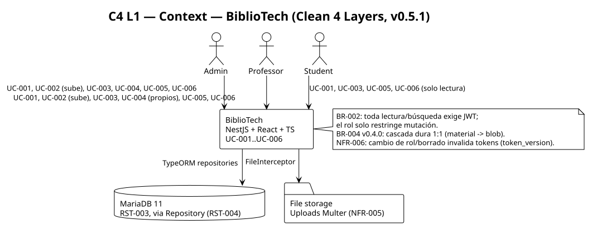
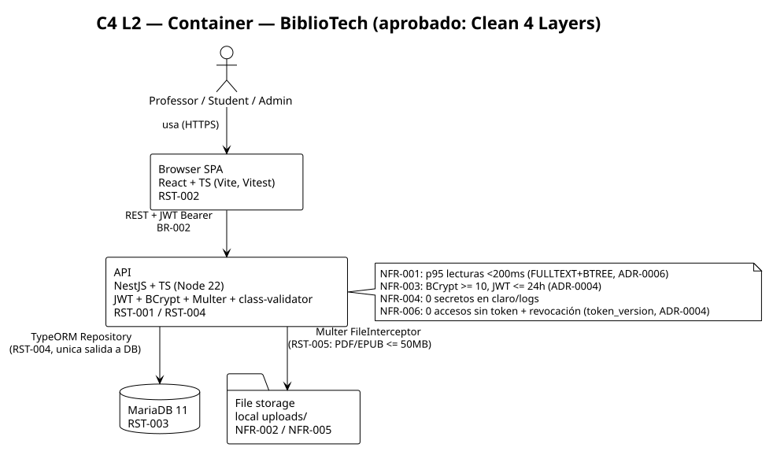
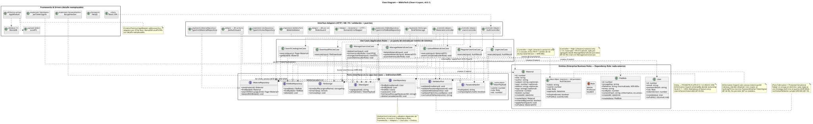
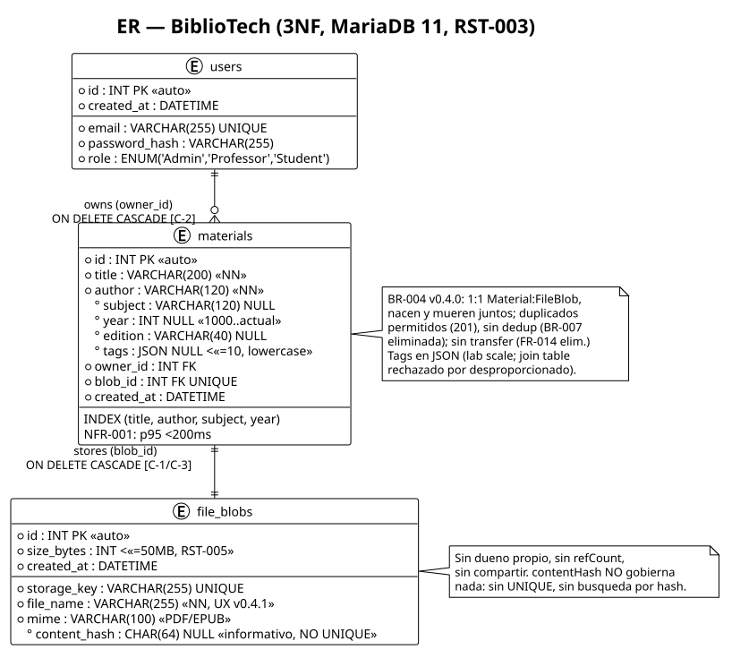

# Architecture — BiblioTech (v0.5.1, aprobado 2026-10-16)

Estilo: **Clean 4 Layers** ([ADR-0001](adrs/0001-clean-4-layer-architecture.md)). Reglas vía Strategy ([ADR-0002](adrs/0002-strategy-for-rules.md)). Persistencia TypeORM + storage local tras puertos ([ADR-0003](adrs/0003-orm-vs-sql.md)). Auth JWT/BCrypt con revocación por `token_version` ([ADR-0004](adrs/0004-auth-jwt-revocation.md)). Cascada dura y consistencia DB/FS ([ADR-0005](adrs/0005-cascade-consistency.md)). Índices para UC-005 ([ADR-0006](adrs/0006-search-indexing.md)).

> Rev. v0.5.1 (2026-10-16): back-edge del CCB post-challenge — resuelve **BT-05** (modelo de diseño), **BT-06** (integridad arquitectónica) y **BT-11** (orden Multer/NFR-005). Reconcilia el diseño con el baseline RE v0.5.0 y registra los **follow-ups** (código y RE) que aún deben converger; **no** afirma que el código ya iguale el diseño.

## C4

## Clases y datos

## Secuencias críticas (las colaboraciones clave citan su GRASP)

- UC-001 auth: `sequence-diagram-UC-001.puml` — Controller → Pure Fabrication (ValidatorPort) → Creator → Indirection (PasswordHasher/UserRepository) → Information Expert (`tokenVersion`). Orden corregido: se carga el `User` antes de comparar (BT-05 §2).
- UC-002 upload 1:1: `sequence-diagram-UC-002.puml` — `FileInterceptor` valida en el borde (memoria + límite + MIME) antes de persistir (BT-11/NFR-005); Creator crea Material + FileBlob nuevos (duplicados → 201).
- UC-003 read-by-id: `sequence-diagram-UC-003.puml` — lectura delgada, 404 por id, todo rol ve todo (BR-002/FR-007).
- UC-004 cascada + revocación: `sequence-diagram-UC-004.puml` — Controller → Information Expert (`isOwnedBy`) → **FS-primero** (idempotente) + transacción DB (ADR-0005) → `tokenVersion` bump (NFR-006).
- UC-005 búsqueda: `sequence-diagram-UC-005.puml` — Strategy de filtros + FULLTEXT/BTREE (ADR-0006), paginación normalizada.
- UC-006 descarga: `sequence-diagram-UC-006.puml` — 401-primero (BR-002), stream + `fileName` normalizado (NFR-005).

## Capas (responsabilidad en 3 líneas por capa)

- **Entities** (User, Material, FileBlob, AuthSession): reglas de empresa puras, cero imports framework. Saben sus datos y su creación/ownership (Information Expert + Creator); `AuthSession` es un Value Object transitorio, sin crypto.
- **Use Cases** (7 `*UseCase`, ports propios): un punto de entrada por evento de sistema (Controller/Command), agrupado por agregado (Material vs Users). Orquestan validación, persistencia y cascada; sin SQL ni HTTP. Expresan sus dependencias como **puertos** (`ValidatorPort`, `PasswordHasher`, `TokenSigner`, `FileStorage`, `*Repository`).
- **Interface Adapters** (controllers, guards, repos TypeORM, Multer storage, `BiblioValidator`): traducen HTTP/DB/FS a los puertos estables (Adapter + Indirection + Pure Fabrication). Toda la variación predicha (reglas, filtros, filename) vive tras Strategy.
- **Frameworks & Drivers** (módulos Nest, `AppModule`, config, `BcryptHasher`, `JwtTokenSigner`, migraciones, SPA React): cableado DI/Factory, JWT/BCrypt configurados (NFR-003/0004). Detalle reemplazable sin tocar el core.

## Dependency Rule

Imports solo hacia adentro (`Frameworks → Adapters → UseCases → Entities`). Los UseCases dependen de **puertos** (interfaces), no de adapters. Gate: 0 imports `@nestjs/*`/typeorm en `entities/` + `usecases/` (review o `dependency-cruiser`).

## Resolución del back-edge CCB (v0.5.1)

| Ticket | Fix arquitectónico |
|--------|--------------------|
| **BT-05** modelo de diseño | `findByEmail`/`create`/`update`/`getById` modelados; orden verify/load corregido; UseCase por agregado (no God-controller); E-001 con **orden FS-primero** (ADR-0005); realización de Strategy/guards; `file_name` en FileBlob/FileStorage; ADR-0004 auth. |
| **BT-06** integridad | `ValidatorPort` en UseCases (no adapter→core); crypto tras `PasswordHasher`/`TokenSigner` (Entities sin framework); FK de cascada corregida + ADR-0005; índices FULLTEXT/BTREE + ADR-0006; claim 3NF calificado; C4 actors→UC; re-aprobación. |
| **BT-11** NFR-005 | `FileInterceptor` (memory + `limits` + `fileFilter`) valida en el borde antes del UseCase; secuencia UC-002 lo fija. |

## Follow-ups abiertos (NO parte del gate architect; trazados para build/RE)

Tras `/ooad-challenge` (fresh-context, v0.5.1) quedan divergencias que el diseño **documenta pero no puede cerrar** por sí solo:

**Código (`ooad-build`)** — el as-built aún no refleja este diseño:
| # | Delta | Evidencia |
|---|-------|-----------|
| B-1 | FK `materials.blob_id → file_blobs` hoy `onDelete:'CASCADE'` (invertida); cambiar a NO ACTION y confiar en la transacción (ADR-0005) | `backend/src/adapters/persistence/typeorm/orm-entities.ts:80` |
| B-2 | Añadir `users.token_version` + claim `ver` + chequeo en `JwtAuthGuard` (ADR-0004, NFR-006) | `backend/src/**` (ausente) |
| B-3 | Split `ManageMaterialUseCase` → `+ ManageUsersUseCase`; orden FS-primero en borrados (E-001) | `manage-material.usecase.ts`, `cascade.spec.ts` |
| B-4 | `ValidatorPort.normalizeFileName` + uso en `FileBlob.create` (NFR-005/BT-10) | `bibliotech-validator.ts`, `upload-material.usecase.ts` |
| B-5 | Índices `FULLTEXT(title,author,subject)` + `BTREE(year)` + `BTREE(created_at)` (ADR-0006) | migraciones/ORM |
| B-6 | UC-006 storage caído → 503 (`DomainErrorCode.SERVICE_UNAVAILABLE`, BUG-002) | `download-file.usecase.ts` |

**RE (`ooad-requirements`, delta-spec)** — contradicen el diseño aprobado. **Resueltos en RE v0.5.2 (2026-10-16)**:
| # | Delta | Evidencia | Cierre |
|---|-------|-----------|--------|
| R-1 | `q` de UC-005 declarado "parcial infijo"; FULLTEXT sirve token/prefijo → redefinir `q` (ADR-0006) | `UC-005-search.md:20` | **Resuelto** — `q` redefinido token/prefijo (UC-005 Query Semantics v0.5.2); RTM `FR-009`/`NFR-001` → `Designed`; B-5 desbloqueado. |
| R-2 | `conceptual-model.puml` aún marca cascada `<<ON DELETE CASCADE>>` y `AuthSession holds` (diseño: NO ACTION / VO transitorio) | `conceptual-model.puml:47-49` | **Resuelto** — estereotipos de cascada (DB FK vs app transaction, ADR-0005) + `AuthSession` VO transitorio (ADR-0004); SVG re-renderizado. |
| R-3 | `crc-cards.md` describe `AuthSession` como "verifica BCrypt; emite/valida JWT" (diseño: crypto tras puertos) | `crc-cards.md:49-56` | **Resuelto** — delega a `PasswordHasher`/`TokenSigner` (ADR-0004). |
| R-4 | UC-003/005/006 "Sequence Diagram … pendiente" ya existen | `UC-003:67`, `UC-005:105`, `UC-006:101` | **Resuelto** — secciones actualizadas con el contenido real de cada diagrama. |
