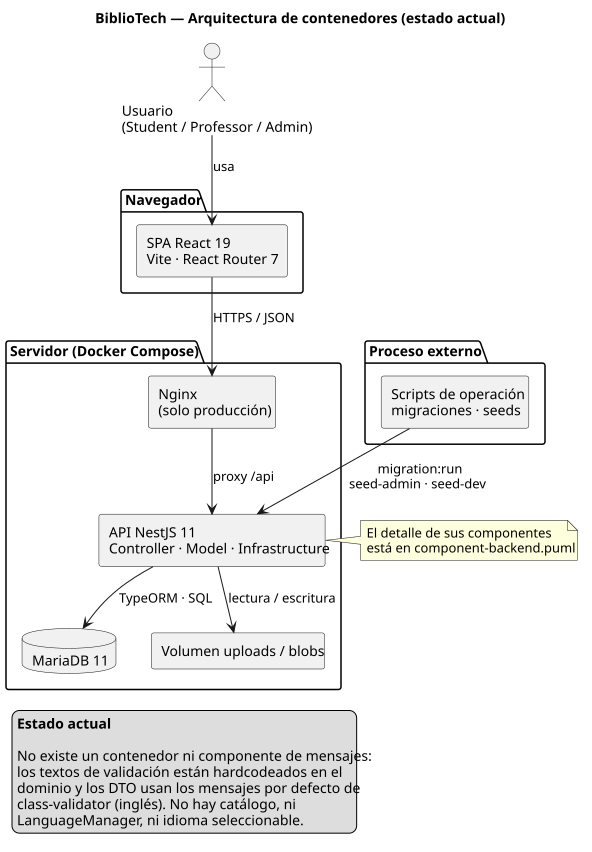
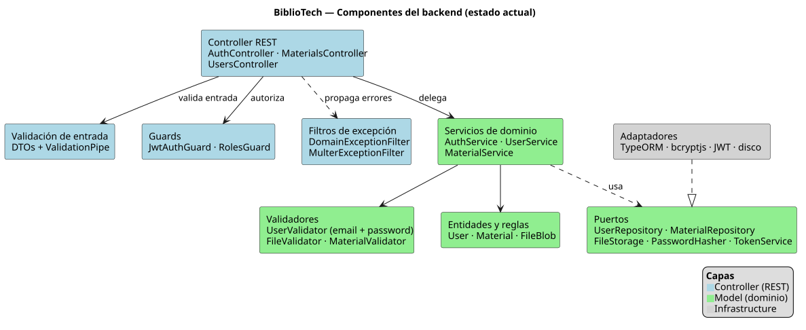

# BiblioTech

Biblioteca digital para materiales académicos. Backend NestJS + MariaDB, frontend React + Vite, entornos Docker separados para desarrollo y producción.

## Inicio rápido (desarrollo)

Requisitos: Docker con Compose v2, `make` y `openssl`.

```bash
make dev
```

El target `init` genera `.env.dev` con secretos aleatorios (no se commitea). Luego levanta:

| Servicio | URL |
| --- | --- |
| Frontend | http://localhost:5173 |
| API | http://localhost:3000/api |
| Healthcheck | http://localhost:3000/api/health |
| Adminer | http://localhost:8081 |
| MariaDB | localhost:3306 |

Los puertos publicados en el host se configuran en `.env.dev` con el sufijo `*_PORT_HOST` (`FRONTEND_PORT`, `API_PORT_HOST`, `DB_PORT_HOST`); los puertos internos de cada servicio son fijos.

El arranque de desarrollo ejecuta migraciones y un seed idempotente con usuarios y materiales de demostración.

### Credenciales demo

| Rol | Email | Contraseña |
| --- | --- | --- |
| Admin | `admin@bibliotech.local` | `Admin1234!` |
| Profesor | `professor@bibliotech.local` | `Professor1234!` |
| Estudiante | `student@bibliotech.local` | `Student1234!` |
| Estudiante | `lucia@bibliotech.local` | `Student1234!` |

Los registros públicos crean siempre cuentas **Student**. Un Admin puede crear usuarios y cambiar roles.

## Stack

- **Backend:** NestJS 11, TypeORM 0.3, MariaDB 11.8, JWT, bcryptjs, class-validator, Joi, Jest.
- **Frontend:** React 19, React Router 7, Vite 7, epub.js, Vitest + Testing Library.
- **Infra:** Docker multi-stage, Compose base + overrides, Nginx para producción, volúmenes para base y archivos.

## Arquitectura

Se usa **MVC distribuido**, documentado en `docs/adr/0001-mvc-distribuido.md`:

| MVC | Implementación |
| --- | --- |
| **Model** | Entidades, validadores, reglas de negocio, puertos y servicios en `backend/src/model`. No depende de Nest ni de TypeORM. |
| **Controller** | Controllers REST, DTOs, guards y filtros en `backend/src/controller`. Traducen HTTP al modelo. |
| **View** | SPA React en `frontend/src`. Consume la API y renderiza catálogo, editor y visor. |

La persistencia vive en `backend/src/infrastructure` detrás de puertos (`UserRepository`, `MaterialRepository`, `FileStorage`, etc.). Los servicios del dominio se construyen con factories en `model.module.ts`.




### Reglas principales

- **Material:** una entidad con `visibilidad` (`OCULTO`/`PUBLICO`) y `publishedAt`.
- **Borrador:** nunca publicado (`publishedAt = null`). **Publicación:** al menos una vez publicado; puede estar oculto o público.
- **Publicar:** exige título, autor y archivo. **Ocultar** conserva `publishedAt`.
- **Eliminar:** soft delete; invisible para todos salvo Admin (404 para el resto). El archivo permanece y el Admin puede restaurar.
- **Catálogo:** solo materiales públicos y no eliminados; búsqueda por título/autor, filtro por materia/año y paginación.
- **Lectura:** el archivo se descarga autenticado por `fetch`; no hay URL pública. PDF en visor nativo, EPUB con epub.js.

## Mensajes de validación e idiomas

Los mensajes de validación y del DTO de autenticación salen de un **catálogo único** en `backend/src/model/messages/`, resuelto en este orden de fallback:

```text
idioma activo → es → validation.resource.invalid
```

### Idiomas soportados

| Clave   | Idioma    |
| --- | --- |
| `es` | Español (por defecto) |
| `en` | Inglés |

El idioma activo se elige por proceso con `APP_LANGUAGE` (valores `es`/`en`, por defecto `es`). Locales no soportados se rechazan al iniciar y `setLanguage` conserva el idioma anterior. No hay idioma por request ni persistencia por usuario en esta iteración.

### Cómo se elige el idioma

1. `APP_LANGUAGE` se valida al arrancar (Joi). Si es inválido, el proceso falla al iniciar.
2. `getLanguage` reporta el idioma activo; `setLanguage(locale)` lo cambia en caliente sin reiniciar.
3. `resolve` (vía `LanguageManager`) toma el idioma activo, cae a `es` y luego al mensaje de recurso inválido. Nunca devuelve `undefined`.

### Cómo agregar una clave nueva

1. Agregar la clave en `backend/src/model/messages/catalog.ts` bajo `es` y bajo `en` con el **mismo conjunto de claves**.
2. Usar la clave en el validador o en el `@Is*Message` del DTO. Ejemplo: `'validation.password.too-short'`.
3. Si el mensaje necesita valores numéricos, usar marcadores `{param}` e pasarlos desde el validador o desde `context` del decorator, p. ej. `resolveMessage('validation.email.too-long', { max: 255 })`.
4. El test de paridad `messages.spec.ts` exige el mismo set de claves en `es` y en `en`; si falta una traducción, el test falla.

### Cómo agregar un idioma nuevo

1. Agregar el nuevo locale en `Locale` en `catalog.ts` y su catálogo completo.
2. Agregarlo a `SUPPORTED_LOCALES` en `catalog.ts`.
3. Actualizar `APP_LANGUAGE` en `backend/src/config/env.validation.ts` (y el ejemplo de entorno).
4. Restaurar `setLanguage` antes de salir de cualquier sub-test para no contaminar las aserciones del resto de la suite.

### Contrato de respuesta

- **Dominio**: `{ statusCode: 400, message: "mensaje localizado", error: "VALIDATION" }`.
- **DTO**: `{ statusCode: 400, message: ["mensaje localizado", ...], error: "Bad Request" }`.
- El `error` nunca se traduce; `message` sí. Los defaults de `class-validator` no llegan al cliente.
- Los parámetros `{min}`/`{max}` reemplazan al valor pasado como argumento al lanzar el error o como `context` en el decorator.

### Cobertura

`jest.config.js` incluye `src/model/messages/**` en `collectCoverageFrom`; el umbral global sigue siendo ≥80% líneas.

## API

Contrato completo en `api/openapi.yaml`.

| Método | Ruta | Acceso |
| --- | --- | --- |
| `POST` | `/api/auth/register` | Público (crea Student) |
| `POST` | `/api/auth/login` | Público |
| `GET` | `/api/auth/me` | Autenticado |
| `GET` | `/api/materials` | Autenticado (catálogo público) |
| `GET` | `/api/materials/mine` | Professor / Admin |
| `GET` | `/api/materials/admin` | Admin (incluye eliminados) |
| `GET` | `/api/materials/:id` | Autenticado según visibilidad |
| `POST` | `/api/materials` | Professor / Admin |
| `PATCH` | `/api/materials/:id` | Dueño / Admin |
| `POST` | `/api/materials/:id/file` | Dueño / Admin (multipart `file`) |
| `POST` | `/api/materials/:id/publish` | Dueño / Admin |
| `POST` | `/api/materials/:id/hide` | Dueño / Admin |
| `DELETE` | `/api/materials/:id` | Dueño / Admin (soft delete) |
| `POST` | `/api/materials/:id/restore` | Admin |
| `GET` | `/api/materials/:id/file` | Autenticado según visibilidad |
| `GET` | `/api/materials/:id/download` | Autenticado según visibilidad |
| `GET` | `/api/users` | Admin |
| `POST` | `/api/users` | Admin |
| `PATCH` | `/api/users/:id/role` | Admin |
| `GET` | `/api/health` | Público |

## Producción

1. Copiar el ejemplo y completar secretos reales:

   ```bash
   cp .env.prod.example .env.prod
   chmod 600 .env.prod
   ```

2. Aplicar migraciones y crear el Admin inicial:

   ```bash
   make prod-migrate
   make prod-seed-admin
   ```

3. Levantar:

   ```bash
   make prod
   ```

Frontend en http://localhost:8080 (Nginx sirve la SPA y hace proxy de `/api` al backend). No hay Adminer ni seed demo. Los secretos se inyectan por entorno y nunca se hornean en las imágenes.

El entorno de producción usa el proyecto Compose `bibliotech-prod`, con volúmenes propios: no reutiliza la base ni los archivos de desarrollo. `make prod-down` detiene solo ese entorno.

## Tests y calidad

```bash
make test            # unitarios backend + frontend
make test-e2e        # API completa contra MariaDB (levanta db y aplica migraciones)
cd backend && npm run test:cov
cd frontend && npm run test:cov
cd backend && npm run lint
cd frontend && npm run lint
```

Los tests e2e usan las credenciales de `.env.dev`, crean usuarios y materiales con sufijo único y limpian sus datos al terminar. Requieren MariaDB accesible en `localhost:3306`; `make test-e2e` levanta el servicio `db`.

Cobertura configurada:

- Backend: ≥80% de líneas en dominio, seguridad, guards, filtros y storage.
- Frontend: ≥70% en módulos críticos (`api`, `auth`, `lib`).

## Documentación

- `GLOSSARY.md` — vocabulario canónico.
- `docs/requirements.md` — requisitos funcionales, no funcionales, reglas e historias Gherkin.
- `docs/adr/` — decisiones de arquitectura y modelo.
- `docs/diagrams/` — casos de uso, clases, ER, componentes y secuencias (`.puml` + `.svg`).
- `api/openapi.yaml` — contrato REST.
- `docs/agents/` — guías de operación para agentes.
- `docs/lab10-verification.md` — evidencia de verificación de Lab 10 (comandos y resultados).

## Estructura

```text
backend/
  src/model/            # Model: entidades, reglas, puertos, servicios
  src/controller/       # Controllers REST, DTOs, guards, filtros
  src/infrastructure/   # TypeORM, storage, JWT, bcrypt, seeds
  test/                 # unit + e2e
frontend/
  src/api/              # cliente tipado
  src/auth/             # sesión y contexto
  src/components/       # tarjetas, modales, visor
  src/pages/            # catálogo, autor, admin, auth
compose.yaml            # base
compose.dev.yaml        # desarrollo (hot reload, Adminer, seed)
compose.prod.yaml       # producción (Nginx, sin devDeps)
```
